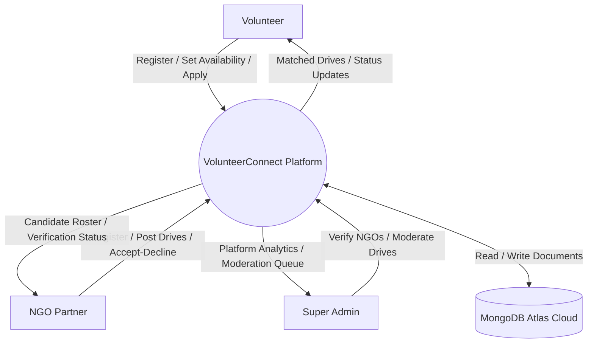
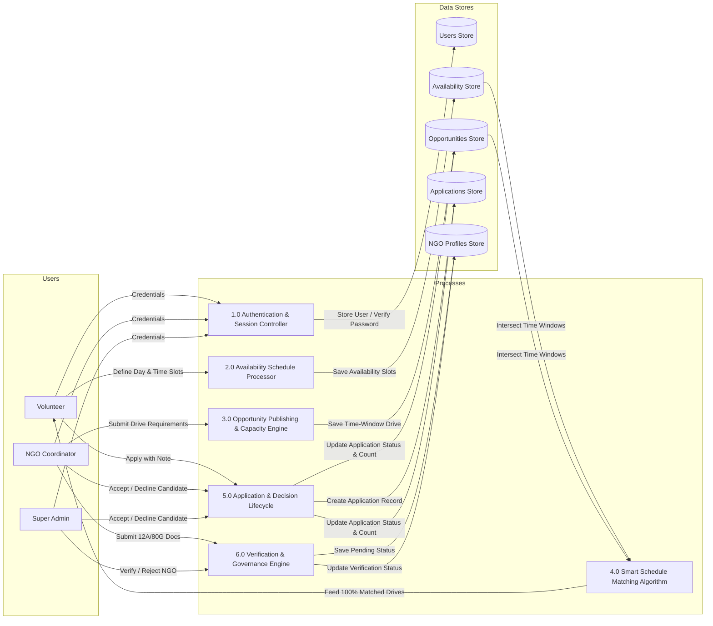
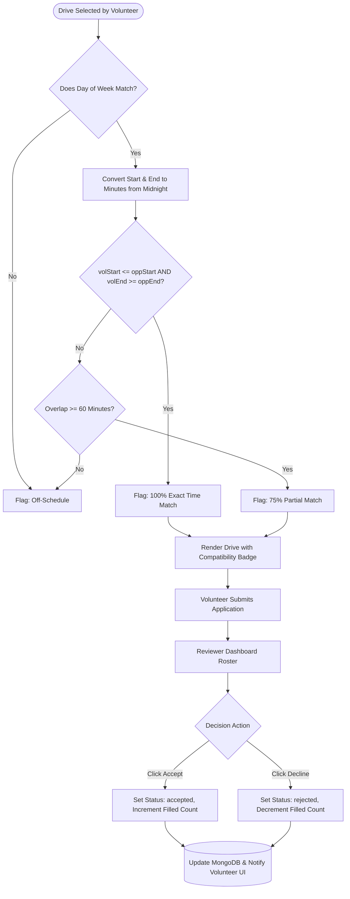

# Software Requirements Specification (SRS) & Project Report
## The Volunteer Availability Problem (NGO Platform) — VolunteerConnect

**Course / Project Title:** Full-Stack Web Development Project  
**Author / Developer:** Md Asif Raja  
**Email:** mdasifraja687@gmail.com  
**Technology Stack:** Next.js 14 (App Router), React 18, Tailwind CSS, MongoDB Atlas, Mongoose, JWT, bcryptjs  
**Academic Year:** 2026  

---

# Table of Contents

- [REVISION HISTORY](#revision-history)
- [1. INTRODUCTION](#1-introduction)
  - [1.1 Purpose](#11-purpose)
  - [1.2 Scope](#12-scope)
  - [1.3 Definitions, Acronyms, and Abbreviations](#13-definitions-acronyms-and-abbreviations)
  - [1.4 References](#14-references)
  - [1.5 Overview](#15-overview)
- [2. GENERAL DESCRIPTION](#2-general-description)
  - [2.1 Product Perspective](#21-product-perspective)
  - [2.2 Product Functions](#22-product-functions)
  - [2.3 User Characteristics](#23-user-characteristics)
  - [2.4 General Constraints](#24-general-constraints)
  - [2.5 Assumptions and Dependencies](#25-assumptions-and-dependencies)
- [3. SPECIFIC REQUIREMENTS](#3-specific-requirements)
  - [3.1 External Interface Requirements](#31-external-interface-requirements)
    - [3.1.1 User Interfaces](#311-user-interfaces)
    - [3.1.2 Hardware Interfaces](#312-hardware-interfaces)
    - [3.1.3 Software Interfaces](#313-software-interfaces)
    - [3.1.4 Communications Interfaces](#314-communications-interfaces)
  - [3.2 Functional Requirements](#32-functional-requirements)
    - [3.2.1 User Registration & Authentication (JWT + bcrypt)](#321-user-registration--authentication-jwt--bcrypt)
    - [3.2.2 NGO Verification & Credential Auditing](#322-ngo-verification--credential-auditing)
    - [3.2.3 Time-Window Opportunity Management](#323-time-window-opportunity-management)
    - [3.2.4 Weekly Volunteer Availability Scheduling](#324-weekly-volunteer-availability-scheduling)
    - [3.2.5 Smart Availability Matching Engine](#325-smart-availability-matching-engine)
    - [3.2.6 Application Lifecycle & Approval Management](#326-application-lifecycle--approval-management)
    - [3.2.7 Super Admin Platform Governance & Moderation](#327-super-admin-platform-governance--moderation)
  - [3.5 Non-Functional Requirements](#35-non-functional-requirements)
    - [3.5.1 Performance](#351-performance)
    - [3.5.2 Reliability](#352-reliability)
    - [3.5.3 Availability](#353-availability)
    - [3.5.4 Security](#354-security)
    - [3.5.5 Maintainability](#355-maintainability)
    - [3.5.6 Portability](#356-portability)
  - [3.7 Design Constraints](#37-design-constraints)
  - [3.9 Other Requirements](#39-other-requirements)
- [4. ANALYSIS MODELS](#4-analysis-models)
  - [4.1 Data Flow Diagrams (DFD)](#41-data-flow-diagrams-dfd)
    - [4.1.1 Level 0 DFD (Context Diagram)](#411-level-0-dfd-context-diagram)
    - [4.1.2 Level 1 DFD (Subsystem Decomposition)](#412-level-1-dfd-subsystem-decomposition)
    - [4.1.3 Level 2 DFD (Smart Matching & Decision Workflow)](#413-level-2-dfd-smart-matching--decision-workflow)
- [5. GITHUB LINK](#5-github-link)
- [6. DEPLOYED LINK](#6-deployed-link)

---

# REVISION HISTORY

| Version | Date | Author | Description of Changes |
| :---: | :---: | :---: | :--- |
| **1.0** | 16-11-2026 | Md Asif Raja | Initial system design, schema creation, and 10-step development roadmap. |
| **1.1** | 16-11-2026 | Md Asif Raja | Converted to Next.js 14 App Router, implemented cached MongoDB pooling, JWT authentication, and interactive Accept/Decline application workflows. |
| **1.2** | 16-11-2026 | Md Asif Raja | Implemented full-stack Dark Mode and Light Mode with persistent `localStorage` and zero-flicker pre-hydration script. |
| **2.0** | 23-11-2026 | Md Asif Raja | Production release: GitHub repository publish, MongoDB Atlas cloud migration, and Vercel cloud deployment. |

---

# 1. INTRODUCTION

### 1.1 PURPOSE
The purpose of this document is to specify the Software Requirements Specification (SRS) for **VolunteerConnect**, a full-stack schedule-driven matchmaking web application. This document details the functional, non-functional, interface, and structural requirements for students, faculty evaluators, and system architects.

### 1.2 SCOPE
VolunteerConnect addresses **The Volunteer Availability Problem**. While non-governmental organizations (NGOs) routinely organize community activities (cleanliness drives, medical camps, teaching sessions) requiring short-term manpower, they struggle to locate willing volunteers free at those exact hours. Simultaneously, civic-minded volunteers do not know when or where their free hours align with genuine causes. VolunteerConnect acts as an automated, verified intermediary matching volunteer recurring schedules with NGO time-window demands.

### 1.3 DEFINITIONS, ACRONYMS, AND ABBREVIATIONS
- **NGO:** Non-Governmental Organization.
- **SRS:** Software Requirements Specification.
- **JWT:** JSON Web Token (RFC 7519) used for stateless authentication.
- **SSR:** Server-Side Rendering (Next.js Server Components).
- **DFD:** Data Flow Diagram.
- **ODM:** Object Data Modeling (Mongoose).
- **REST:** Representational State Transfer.
- **bcrypt:** Adaptive cryptographic key-derivation function for password hashing.
- **XSS:** Cross-Site Scripting.
- **CSRF:** Cross-Site Request Forgery.

### 1.4 REFERENCES
1. IEEE Std 830-1998: *IEEE Recommended Practice for Software Requirements Specifications*.
2. Next.js 14 Documentation — App Router, Server Actions, Route Handlers (`https://nextjs.org/docs`).
3. MongoDB & Mongoose Object Modeling Manual (`https://mongoosejs.com`).
4. RFC 7519 — JSON Web Token (JWT) Standard.

### 1.5 OVERVIEW
The remainder of this specification describes the high-level perspective of the application, functional requirements across its three user roles, non-functional quality attributes, and architectural analysis models (Data Flow Diagrams).

---

# 2. GENERAL DESCRIPTION

### 2.1 PRODUCT PERSPECTIVE
VolunteerConnect is an independent, responsive, cloud-hosted web system designed to bridge civil society organizations and community volunteers. It replaces ad-hoc WhatsApp broadcasts and fragmented social media callouts with a deterministic, verified schedule intersection algorithm.

```
+--------------------------------------------------------------------------+
|                         VolunteerConnect Platform                         |
|                                                                          |
|   +-------------------+    +--------------------+    +---------------+   |
|   |  Volunteer Portal |    |    NGO Partner     |    |  Super Admin  |   |
|   | (Schedule & Apply)|    | (Drives & Reviews) |    | (Governance)  |   |
|   +---------+---------+    +---------+----------+    +-------+-------+   |
|             |                        |                       |           |
|             +------------------------+-----------------------+           |
|                                      |                                   |
|                     +----------------v---------------+                   |
|                     |     Next.js 14 App Router      |                   |
|                     |  Route Handlers & Server Logic |                   |
|                     +----------------+---------------+                   |
|                                      |                                   |
|                     +----------------v---------------+                   |
|                     |     MongoDB Atlas Cloud DB     |                   |
|                     | (Users, Drives, Availability)  |                   |
|                     +--------------------------------+                   |
+--------------------------------------------------------------------------+
```

### 2.2 PRODUCT FUNCTIONS
- **Role-Based Authentication:** Multi-tier authentication for Volunteers, NGO Representatives, and Super Administrators.
- **Legal NGO Verification:** Verification mechanism for NGO registration IDs (12A/80G).
- **Dynamic Drive Publisher:** Time-slotted opportunity creation with target capacity counters.
- **Interactive Schedule Matrix:** Day-of-week and hourly window availability selector for volunteers with one-click presets.
- **Smart Compatibility Matching:** Automated algorithm calculating percentage schedule overlaps.
- **Two-Way Application Lifecycle:** Real-time application submission, status transitions (`pending` -> `accepted` / `rejected`), and headcount tracking.
- **Theme Adaptability:** Complete dark and light theme rendering with persistent client state.

### 2.3 USER CHARACTERISTICS
1. **Volunteers:** Students, professionals, or retirees willing to offer 2–5 hours on specific days. They need quick onboarding and clear visibility into drives fitting their calendar.
2. **NGO Coordinators:** Field managers responsible for drive execution. They require fast headcount fulfillment and candidate reliability verification.
3. **Super Administrators:** Platform regulators ensuring legal validity of participating NGOs and moderating counterfeit listings.

### 2.4 GENERAL CONSTRAINTS
- **Architecture:** Full-stack unified Next.js 14 App Router (React 18 + Node.js 18+).
- **Database:** MongoDB 8.x Atlas cloud cluster with Mongoose ODM connection pooling.
- **Security:** HTTP-only SameSite cookies for tokens; passwords hashed with 10-round bcrypt salts.
- **Browser Compatibility:** Responsive layout supporting Chromium, Firefox, Safari, and Edge.

### 2.5 ASSUMPTIONS AND DEPENDENCIES
- Users possess an internet-enabled desktop, tablet, or smartphone.
- The MongoDB Atlas cluster is accessible via port 27017 / SRV connection.

---

# 3. SPECIFIC REQUIREMENTS

## 3.1 EXTERNAL INTERFACE REQUIREMENTS

### 3.1.1 User Interfaces
- **Visual Design:** Designed using Tailwind CSS with modern rounded geometry (`rounded-2xl`, `rounded-3xl`), emerald/teal accents, and accessible typography.
- **Responsive Navigation Bar:** Sticky top header featuring logo, role-sensitive navigation links, interactive **Dark Mode / Light Mode toggle**, and user session badge.
- **Volunteer Schedule Grid:** Visual time selector allowing rapid addition and deletion of day/hour slots.
- **Reviewer Action Console:** Actionable candidate cards featuring prominent side-by-side **Accept** (green) and **Decline** (red) decision triggers.

### 3.1.2 Hardware Interfaces
- No specialized hardware required; runs standard input/output protocols on client smartphones, tablets, laptops, and PCs.

### 3.1.3 Software Interfaces
- **Client Runtime:** Modern web browsers supporting ECMAScript 2022+ and HTML5.
- **Server Runtime:** Node.js v18.0.0 or higher.
- **Database Engine:** MongoDB 8.x via Mongoose ODM cached connection.
- **Deployment Platform:** Vercel Serverless / Edge Runtime.

### 3.1.4 Communications Interfaces
- HTTPS protocol for all client-server exchanges.
- RESTful JSON payloads via Route Handlers (`app/api/**`).
- Stateless cookie transmission via standard `Set-Cookie` headers.

---

## 3.2 FUNCTIONAL REQUIREMENTS

### 3.2.1 User Registration & Authentication (JWT + bcrypt)
- **ID:** `FR-01`
- **Description:** Secure onboarding and session management.
- **Details:**
  - Password hashed via Mongoose pre-save hook using `bcrypt.genSalt(10)` and `bcrypt.hash()`.
  - Registration bifurcated: Volunteers provide personal contact info; NGOs provide organization name, cause, and 12A/80G registration number.
  - JWT issued upon successful authentication, valid for 30 days, encoded into an `httpOnly`, `sameSite: 'strict'` cookie.
  - One-click demo login buttons provided for immediate prototype evaluation.

### 3.2.2 NGO Verification & Credential Auditing
- **ID:** `FR-02`
- **Description:** Legal verification of registered NGOs by Super Admin.
- **Details:**
  - Registered NGOs are automatically assigned `verificationStatus: 'pending'`.
  - Super Admin console displays pending organizations in the **NGO Verification Queue**.
  - Admins can verify or reject applications with administrative remarks.
  - Verified NGOs receive a verified badge and full platform drive publishing privileges.

### 3.2.3 Time-Window Opportunity Management
- **ID:** `FR-03`
- **Description:** Time-bound opportunity creation and headcount management.
- **Details:**
  - NGOs create drives specifying title, cause category, event date, start time, end time, venue, and required volunteer headcount.
  - Real-time tracking of filled versus needed volunteers with an automated status shift to `closed` when capacity is reached.

### 3.2.4 Weekly Volunteer Availability Scheduling
- **ID:** `FR-04`
- **Description:** Volunteer recurring weekly calendar definition.
- **Details:**
  - Volunteers define multiple recurring availability windows (`dayOfWeek`, `startTime`, `endTime`, `notes`).
  - One-click preset configurations:
    - *Weekend Warrior:* Saturday & Sunday (09:00 - 13:00)
    - *Sunday Cleanliness Dedicated:* Sunday (08:30 - 13:30)
    - *Weekday Evenings:* Tuesday & Thursday (17:00 - 20:00)
  - Upsert persistence in MongoDB via `VolunteerAvailability` collection.

### 3.2.5 Smart Availability Matching Engine
- **ID:** `FR-05`
- **Description:** Automated schedule intersection algorithm.
- **Details:**
  - Converts human-readable time strings (`HH:MM`) into integer minutes from midnight.
  - Evaluates drive day against volunteer days and calculates window overlap:
    - **100% Match:** Volunteer availability entirely encloses drive time window.
    - **75% Partial Match:** At least 60 minutes overlap with the scheduled drive.
    - **Off-Schedule:** No time alignment.
  - Matched drives rendered with pulsing **★ 100% Time Match** badges and filter toggles.

### 3.2.6 Application Lifecycle & Approval Management
- **ID:** `FR-06`
- **Description:** Application submission, reviewer evaluation, and status tracking.
- **Details:**
  - Volunteers submit applications with custom introductory notes.
  - NGOs and Super Admins review candidates sorted by schedule compatibility.
  - Interactive **Accept** and **Decline** controls allow dynamic decision adjustments.
  - Volunteers track outcomes on `/volunteer/applications` with distinct status badges (`UNDER REVIEW`, `CONFIRMED`, `DECLINED`).

### 3.2.7 Super Admin Platform Governance & Moderation
- **ID:** `FR-07`
- **Description:** System-wide oversight and analytics.
- **Details:**
  - Moderate or delete counterfeit or inappropriate drives.
  - Master applicant management across all registered community organizations.
  - High-level analytics counters tracking total volunteers, verified NGOs, and drives completed.

---

## 3.5 NON-FUNCTIONAL REQUIREMENTS

### 3.5.1 Performance
- **Server-Side Rendering (SSR):** Home page initial paint renders under 1.2 seconds on 3G connections.
- **API Latency:** Route Handlers respond within <200ms under cached database pooling.
- **Optimized Bundle:** Total first-load JavaScript shared by all pages optimized to under 90 kB.

### 3.5.2 Reliability
- **Connection Resiliency:** Global Mongoose connection pooling prevents socket exhaustion on Vercel serverless execution.
- **Graceful Error Handling:** Form validations and error boundaries display non-blocking user feedback.

### 3.5.3 Availability
- Designed for 99.9% uptime backed by Vercel's global CDN and MongoDB Atlas multi-zone replica clusters.

### 3.5.4 Security
- Passwords protected against rainbow table attacks via salt-based bcrypt hashing.
- XSS immunity for tokens through `httpOnly` cookie encapsulation.
- Strict role verification middleware (`checkRole`) enforcing principle of least privilege.
- Network whitelisting (`0.0.0.0/0`) securely managed within Atlas IAM.

### 3.5.5 Maintainability
- Clean modular directory layout based on Next.js 14 App Router conventions.
- Declarative UI components separated into reusable atoms in `components/`.

### 3.5.6 Portability
- Platform agnostic; zero operating system lock-in. Builds identically on Windows, Linux, and macOS.

---

## 3.7 DESIGN CONSTRAINTS
- Strict adherence to App Router folder conventions (`app/`, `page.jsx`, `layout.jsx`, `route.js`).
- Database schema enforced via Mongoose models with validation rules.

## 3.9 OTHER REQUIREMENTS
- **Accessibility:** High contrast compliance across both Dark and Light themes.
- **Auditability:** Timestamp tracking (`createdAt`, `decidedAt`) on all application lifecycle transitions.

---

# 4. ANALYSIS MODELS

## 4.1 DATA FLOW DIAGRAMS (DFD)

### 4.1.1 Level 0 DFD (Context Diagram)
The Level 0 Context Diagram depicts the high-level boundary of VolunteerConnect, identifying external entities and primary information flows.



---

### 4.1.2 Level 1 DFD (Subsystem Decomposition)
The Level 1 DFD decomposes the system into core functional processes: Authentication, Schedule Management, Drive Management, Matching Engine, and Application Decisioning.



---

### 4.1.3 Level 2 DFD (Smart Matching & Decision Workflow)
The Level 2 DFD illustrates the granular algorithmic flow during time-window matchmaking and application decision updates.



---

# 5. GITHUB LINK

The complete source code, documentation, schemas, and historical git commits for this project are publicly available on GitHub:

🔗 **GitHub Repository:**  
[https://github.com/asif123-456/Volunteer-availability-platform-project](https://github.com/asif123-456/Volunteer-availability-platform-project)

---

# 6. DEPLOYED LINK

The project is deployed and live on cloud infrastructure powered by Vercel and MongoDB Atlas:

🌐 **Live Deployed Application (Vercel):**  
[https://volunteer-availability-platform-project.vercel.app](https://volunteer-availability-platform-project.vercel.app)

💻 **Localhost Testing Environment:**  
[http://localhost:3001](http://localhost:3001)

---
*Report prepared and submitted in partial fulfillment of the requirements for the Software Engineering & Web Technologies Laboratory Evaluation, 2026.*
