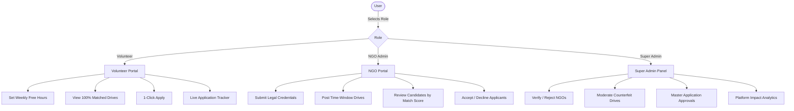

# 🤝 The Volunteer Availability Problem (NGO Platform)
### Full-Stack Next.js 14 (App Router) + MongoDB Architecture with Dark & Light Mode

> A verified, schedule-driven matchmaking platform connecting NGOs needing short-term volunteers with community helpers available at that exact date and time.

---

## 📖 Table of Contents
1. [Project Overview & Problem Statement](#-project-overview--problem-statement)
2. [Syllabus & Core Next.js 14 Concepts](#-syllabus--core-nextjs-14-concepts)
3. [The 10-Step Full-Stack Development Implementation](#-the-10-step-full-stack-development-implementation)
   - [Step 1: MongoDB Database Connection & Cached Pooling](#step-1-mongodb-database-connection--cached-pooling)
   - [Step 2: User Registration API with Role Separation](#step-2-user-registration-api-with-role-separation)
   - [Step 3: Password Hashing using bcrypt](#step-3-password-hashing-using-bcrypt)
   - [Step 4: Login API using JWT & HTTP-Only Cookies](#step-4-login-api-using-jwt--http-only-cookies)
   - [Step 5: Role-based Authentication & Route Protection](#step-5-role-based-authentication--route-protection)
   - [Step 6: NGO Legal Credential Verification](#step-6-ngo-legal-credential-verification)
   - [Step 7: Create & Manage Time-Slotted Opportunities](#step-7-create--manage-time-slotted-opportunities)
   - [Step 8: Volunteer Weekly Availability Schedule](#step-8-volunteer-weekly-availability-schedule)
   - [Step 9: Smart Availability Matching Algorithm](#step-9-smart-availability-matching-algorithm)
   - [Step 10: Volunteer Application & Interactive Approval System](#step-10-volunteer-application--interactive-approval-system)
4. [Dark Mode & Light Mode Theme Engine](#-dark-mode--light-mode-theme-engine)
5. [User Roles & Portal Capabilities](#-user-roles--portal-capabilities)
6. [Pre-Seeded Demo Accounts](#-pre-seeded-demo-accounts)
7. [Project Directory Structure](#-project-directory-structure)
8. [Installation & Setup Guide](#-installation--setup-guide)

---

## 🎯 Project Overview & Problem Statement

### The Problem:
- **For NGOs & Local Organizers:** Often need volunteers for short activities (e.g. Sunday beach cleanup, Saturday food distribution camp, weekend tutoring) but struggle to find people who are **actually available at the required time**.
- **For Willing Volunteers:** People want to contribute to social causes but don't know where help is needed or find opportunities that conflict with their college or work schedule.

### The Solution:
**VolunteerConnect** solves this mismatch through a **smart schedule-driven matchmaking engine**. Volunteers declare their recurring free days and time slots (e.g. *Sundays 9:00 AM – 1:00 PM*), and NGOs publish opportunities with specific time windows. The algorithm automatically intersects these schedules and presents volunteers with **100% time-slot verified drives**.

---

## 🚀 Syllabus & Core Next.js 14 Concepts

| Concept | File Location | Purpose & Implementation |
| :--- | :--- | :--- |
| **App Router** | `app/` | Modern Next.js file-system routing using layouts, templates, and nested route folders. |
| **Route Handlers** | `app/api/**/route.js` | REST API endpoints handling auth, opportunities, availability, and moderation. |
| **Server-Side Rendering (SSR)** | `app/page.jsx` | Async server component fetching live database statistics directly on the server before sending HTML. |
| **Client Components** | `'use client'` | Interactive schedule grids, live filters, modals, and instant 1-click login buttons. |
| **Server Actions** | `app/actions/` | Server-executed mutations for availability updates and NGO status decisions. |
| **Mongoose Connection Pooling** | `lib/mongodb.js` | Global cached connection handling across fast hot reloads and serverless requests. |
| **JWT & Password Security** | `lib/auth.js`, `models/User.js` | Secure stateless auth with `bcryptjs` one-way salt hashing and HTTP-only cookies. |

---

## 🛠️ The 10-Step Full-Stack Development Implementation

### Step 1: MongoDB Database Connection & Cached Pooling
- **Files:** [`lib/mongodb.js`](file:///c:/Users/mdasi/OneDrive/Desktop/The%20Volunteer%20Availability%20Problem%20(NGO)%20Project/lib/mongodb.js)
- **Problem Solved:** Next.js repeatedly re-executes API routes, which can create hundreds of redundant database connections and exhaust the MongoDB connection pool.
- **Implementation:**
  - Implemented a **singleton cached connection pattern** using Node’s `global` object.
  - Reuses an existing Mongoose connection across route handler invocations.
  - Automatically handles connection errors with reconnect logic.
```javascript
// lib/mongodb.js
let cached = global.mongoose || { conn: null, promise: null };
export default async function connectDB() {
  if (cached.conn) return cached.conn;
  if (!cached.promise) {
    cached.promise = mongoose.connect(MONGODB_URI, { bufferCommands: false });
  }
  cached.conn = await cached.promise;
  return cached.conn;
}
```

---

### Step 2: User Registration API with Role Separation
- **Files:** [`app/api/auth/register/route.js`](file:///c:/Users/mdasi/OneDrive/Desktop/The%20Volunteer%20Availability%20Problem%20(NGO)%20Project/app/api/auth/register/route.js), [`app/register/page.jsx`](file:///c:/Users/mdasi/OneDrive/Desktop/The%20Volunteer%20Availability%20Problem%20(NGO)%20Project/app/register/page.jsx)
- **Problem Solved:** NGOs and Volunteers have completely different registration requirements. Volunteers need individual profiles, while NGOs require legal credentials.
- **Implementation:**
  - Dynamic registration endpoint that handles both `volunteer` and `ngo` roles.
  - For volunteers: registers name, email, phone, and city.
  - For NGOs: simultaneously creates a `User` entry and an associated `NgoProfile` record containing registration number (12A/80G), primary cause, and organization bio with an initial status of `'pending'`.
  - Issues a signed JWT immediately upon registration so the user is auto-logged in.

---

### Step 3: Password Hashing using bcrypt
- **Files:** [`models/User.js`](file:///c:/Users/mdasi/OneDrive/Desktop/The%20Volunteer%20Availability%20Problem%20(NGO)%20Project/models/User.js)
- **Problem Solved:** Storing plain-text passwords is a major vulnerability. Passwords must be hashed using a cryptographic salt.
- **Implementation:**
  - Mongoose `pre('save')` lifecycle hook automatically checks `this.isModified('password')`.
  - Generates a 10-round salt using `bcrypt.genSalt(10)` and hashes the password with `bcrypt.hash()`.
  - Added schema instance method `matchPassword(enteredPassword)` that uses `bcrypt.compare()` for secure verification during login.
```javascript
userSchema.pre('save', async function (next) {
  if (!this.isModified('password')) return next();
  const salt = await bcrypt.genSalt(10);
  this.password = await bcrypt.hash(this.password, salt);
  next();
});
```

---

### Step 4: Login API using JWT & HTTP-Only Cookies
- **Files:** [`app/api/auth/login/route.js`](file:///c:/Users/mdasi/OneDrive/Desktop/The%20Volunteer%20Availability%20Problem%20(NGO)%20Project/app/api/auth/login/route.js), [`lib/auth.js`](file:///c:/Users/mdasi/OneDrive/Desktop/The%20Volunteer%20Availability%20Problem%20(NGO)%20Project/lib/auth.js)
- **Problem Solved:** Storing tokens in `localStorage` makes them susceptible to Cross-Site Scripting (XSS).
- **Implementation:**
  - Signs a JSON Web Token payload (`id`, `role`, `name`, `email`) with `JWT_SECRET` valid for 30 days.
  - Transmits the token inside a secure, `httpOnly: true`, `sameSite: 'strict'` browser cookie (`token`).
  - Added 1-Click Quick Demo Login buttons on `/login` for instant role testing (Volunteer, NGO, Super Admin).

---

### Step 5: Role-based Authentication & Route Protection
- **Files:** [`lib/auth.js`](file:///c:/Users/mdasi/OneDrive/Desktop/The%20Volunteer%20Availability%20Problem%20(NGO)%20Project/lib/auth.js), [`components/AuthProvider.jsx`](file:///c:/Users/mdasi/OneDrive/Desktop/The%20Volunteer%20Availability%20Problem%20(NGO)%20Project/components/AuthProvider.jsx)
- **Problem Solved:** Preventing unauthorized users from accessing sensitive portals (e.g., volunteers accessing the Super Admin panel or posting drives).
- **Implementation:**
  - Helper function `getAuthUser(req)` extracts and verifies tokens from either HTTP-only cookies or Authorization headers.
  - Helper function `checkRole(user, allowedRoles)` enforces access control.
  - Client-side React `AuthProvider` context shares authentication state across all components and automatically redirects users based on their active role.

---

### Step 6: NGO Legal Credential Verification
- **Files:** [`models/NgoProfile.js`](file:///c:/Users/mdasi/OneDrive/Desktop/The%20Volunteer%20Availability%20Problem%20(NGO)%20Project/models/NgoProfile.js), [`app/api/admin/ngos/[id]/verify/route.js`](file:///c:/Users/mdasi/OneDrive/Desktop/The%20Volunteer%20Availability%20Problem%20(NGO)%20Project/app/api/admin/ngos/[id]/verify/route.js), [`app/admin/panel/page.jsx`](file:///c:/Users/mdasi/OneDrive/Desktop/The%20Volunteer%20Availability%20Problem%20(NGO)%20Project/app/admin/panel/page.jsx)
- **Problem Solved:** Prevents fake organizations from exploiting volunteers.
- **Implementation:**
  - NGOs register with government registration numbers (12A/80G) and start in a `'pending'` state.
  - The **Super Admin Console** features an **NGO Verification Queue** displaying organization credentials, cause, and contact information.
  - Super Admin can click **Verify NGO** (marks `verificationStatus: 'verified'`) or **Reject** with administrative remarks.
  - Verified NGOs receive a prominent green **100% Super Admin Verified** badge.

---

### Step 7: Create & Manage Time-Slotted Opportunities
- **Files:** [`models/Opportunity.js`](file:///c:/Users/mdasi/OneDrive/Desktop/The%20Volunteer%20Availability%20Problem%20(NGO)%20Project/models/Opportunity.js), [`app/api/opportunities/route.js`](file:///c:/Users/mdasi/OneDrive/Desktop/The%20Volunteer%20Availability%20Problem%20(NGO)%20Project/app/api/opportunities/route.js), [`app/ngo/create-opportunity/page.jsx`](file:///c:/Users/mdasi/OneDrive/Desktop/The%20Volunteer%20Availability%20Problem%20(NGO)%20Project/app/ngo/create-opportunity/page.jsx)
- **Problem Solved:** Volunteer drives need exact time windows and headcount limits rather than open-ended job postings.
- **Implementation:**
  - NGOs post opportunities with: Title, Category, Event Date, Day of Week, Start Time, End Time, Required Volunteers, Venue, and City.
  - Dynamically calculates `dayOfWeek` from `eventDate`.
  - Tracks `filledVolunteers` progress in real-time with an interactive visual progress bar.
  - Automatically transitions status to `'closed'` when required volunteers are filled.

---

### Step 8: Volunteer Weekly Availability Schedule
- **Files:** [`models/VolunteerAvailability.js`](file:///c:/Users/mdasi/OneDrive/Desktop/The%20Volunteer%20Availability%20Problem%20(NGO)%20Project/models/VolunteerAvailability.js), [`app/api/volunteer/availability/route.js`](file:///c:/Users/mdasi/OneDrive/Desktop/The%20Volunteer%20Availability%20Problem%20(NGO)%20Project/app/api/volunteer/availability/route.js), [`app/volunteer/availability/page.jsx`](file:///c:/Users/mdasi/OneDrive/Desktop/The%20Volunteer%20Availability%20Problem%20(NGO)%20Project/app/volunteer/availability/page.jsx)
- **Problem Solved:** Volunteers don't have time every day; they need to declare flexible recurring free hours.
- **Implementation:**
  - Interactive schedule matrix where volunteers add, edit, or delete availability slots (`dayOfWeek`, `startTime`, `endTime`, `notes`).
  - Added **1-Click Quick Presets**:
    - 🌟 **Weekend Warrior:** Saturday & Sunday mornings (9:00 AM – 1:00 PM)
    - 🧹 **Sunday Cleanliness Dedicated:** Sunday 8:30 AM – 1:30 PM
    - 📚 **Weekday Afternoons & Evenings:** Tuesday & Thursday 5:00 PM – 8:00 PM
  - Persists schedule slots to MongoDB with upsert logic.

---

### Step 9: Smart Availability Matching Algorithm
- **Files:** [`lib/matching.js`](file:///c:/Users/mdasi/OneDrive/Desktop/The%20Volunteer%20Availability%20Problem%20(NGO)%20Project/lib/matching.js), [`app/api/volunteer/opportunities/route.js`](file:///c:/Users/mdasi/OneDrive/Desktop/The%20Volunteer%20Availability%20Problem%20(NGO)%20Project/app/api/volunteer/opportunities/route.js)
- **Problem Solved:** The core heart of the platform — connecting volunteer free hours with NGO requirements without manual searching.
- **Algorithm Logic:**
  1. Compares opportunity `dayOfWeek` against volunteer's declared available days.
  2. Parses time windows into integer minutes from midnight (`HH * 60 + MM`).
  3. Evaluates schedule intersection:
     - **100% Match:** Volunteer availability completely covers or matches the drive window (`volStart <= oppStart` and `volEnd >= oppEnd`).
     - **75% Partial Match:** At least 60 minutes of overlap between both windows.
     - **Off-Schedule:** No time overlap.
  4. On the frontend, matched drives display a pulsing green **★ 100% Time Match** badge, and users can toggle **"Only Show Free on My Schedule"**.

---

### Step 10: Volunteer Application & Interactive Approval System
- **Files:** [`models/Application.js`](file:///c:/Users/mdasi/OneDrive/Desktop/The%20Volunteer%20Availability%20Problem%20(NGO)%20Project/models/Application.js), [`app/api/applications/route.js`](file:///c:/Users/mdasi/OneDrive/Desktop/The%20Volunteer%20Availability%20Problem%20(NGO)%20Project/app/api/applications/route.js), [`app/api/applications/[id]/status/route.js`](file:///c:/Users/mdasi/OneDrive/Desktop/The%20Volunteer%20Availability%20Problem%20(NGO)%20Project/app/api/applications/[id]/status/route.js), [`app/ngo/opportunities/[id]/applicants/page.jsx`](file:///c:/Users/mdasi/OneDrive/Desktop/The%20Volunteer%20Availability%20Problem%20(NGO)%20Project/app/ngo/opportunities/[id]/applicants/page.jsx), [`app/admin/panel/page.jsx`](file:///c:/Users/mdasi/OneDrive/Desktop/The%20Volunteer%20Availability%20Problem%20(NGO)%20Project/app/admin/panel/page.jsx)
- **Problem Solved:** Allows NGOs and Super Admins to review applicants and make active decisions to accept or decline candidates.
- **Implementation:**
  - Volunteers apply with a 1-click modal, passing schedule match score and custom message.
  - **Interactive Action Controls:** Both NGO Applicant Review and Super Admin Panel display active side-by-side **Accept** (Green button) and **Decline** (Red button) controls.
  - Reviewers can freely accept or decline applicants at any time with live count recalculations.
  - **Volunteer Status Tracker (`/volunteer/applications`):** Displays real-time status cards:
    - `⏳ PENDING REVIEW` (Amber badge)
    - `✓ CONFIRMED (ACCEPTED)` (Green badge)
    - `✕ DECLINED` (Rose badge with NGO remarks)

---

## 🌗 Dark Mode & Light Mode Theme Engine

- **Class-Based Architecture:** Configured `darkMode: 'class'` in `tailwind.config.js`.
- **Zero-Flicker Pre-Hydration:** Inline execution script in `<head>` immediately detects `localStorage` or `prefers-color-scheme` to prevent light/dark flashes.
- **Dedicated Sun / Moon Toggle:** Responsive theme toggle in both desktop navbar and mobile drawer.
- **Consistent Styling:** High-contrast palette (`dark:bg-slate-900`, `dark:text-slate-100`, `dark:border-slate-800`) across all cards, modals, and tables.

---

## 👥 User Roles & Portal Capabilities



---

## 🔑 Pre-Seeded Demo Accounts

You can test every feature instantly using the **1-Click Quick Demo Login** buttons on the Sign In page:

| Role | Email | Password | Access / State |
| :--- | :--- | :--- | :--- |
| **Volunteer** | `volunteer@gmail.com` | `volunteer123` | Free on weekends; applied to Beach Cleanliness Drive |
| **Verified NGO** | `ngo@greenearth.org` | `ngo12345` | Green Earth Foundation (Verified); 2 posted drives |
| **Pending NGO** | `ngo2@helpinghands.org` | `ngo12345` | Helping Hands Trust; in Super Admin Verification Queue |
| **Super Admin** | `admin@volunteer.org` | `admin12345` | Master platform governance, approvals & verification |

---

## 📂 Project Directory Structure

```
├── app/
│   ├── actions/                       # Next.js Server Actions
│   │   ├── ngoActions.js
│   │   └── volunteerActions.js
│   ├── admin/panel/page.jsx           # Super Admin Console
│   ├── api/                           # Next.js Route Handlers (REST APIs)
│   │   ├── admin/ngos/                # NGO verification endpoints
│   │   ├── admin/reports/             # Impact analytics
│   │   ├── applications/              # Application submission & status
│   │   ├── auth/                      # Register, login, me, logout
│   │   ├── opportunities/             # Drive posting & search
│   │   └── volunteer/                 # Availability & smart matched feed
│   ├── login/page.jsx                 # 1-Click demo authentication
│   ├── ngo/
│   │   ├── create-opportunity/        # Time-window drive publisher
│   │   ├── dashboard/                 # NGO overview & counters
│   │   └── opportunities/[id]/applicants/ # Applicant review with Accept/Decline
│   ├── register/page.jsx              # Role-separated registration
│   ├── volunteer/
│   │   ├── applications/page.jsx      # Live application tracker
│   │   ├── availability/page.jsx      # Weekly schedule matrix & presets
│   │   └── dashboard/page.jsx         # Smart availability matched feed
│   ├── globals.css                    # Tailwind & theme variables
│   ├── layout.jsx                     # Root layout with pre-hydration script
│   └── page.jsx                       # SSR Home Page with MongoDB live stats
├── components/
│   ├── AuthProvider.jsx               # React authentication context
│   ├── Footer.jsx                     # Global footer with syllabus links
│   ├── Navbar.jsx                     # Sticky navigation & Dark/Light toggle
│   └── ThemeProvider.jsx              # React theme context & localStorage sync
├── lib/
│   ├── auth.js                        # JWT signing & role verification
│   ├── matching.js                    # Time-window overlap algorithm
│   └── mongodb.js                     # Cached Mongoose connection pooling
├── models/                            # Mongoose Schemas
│   ├── Application.js                 # Volunteer applications & decisions
│   ├── NgoProfile.js                  # NGO legal credentials & status
│   ├── Opportunity.js                 # Drive requirements & headcount
│   ├── User.js                        # User auth & bcrypt pre-save hashing
│   └── VolunteerAvailability.js       # Weekly recurring time slots
├── seed.js                            # Database seed script with test data
└── tailwind.config.js                 # Tailwind config with darkMode: 'class'
```

---

## 🏃 Installation & Setup Guide

### 1. Prerequisites
- **Node.js** v18+ installed
- **MongoDB** running locally on port `27017`

### 2. Environment Configuration
Create a `.env.local` file in the root directory:
```env
MONGODB_URI=mongodb://127.0.0.1:27017/volunteer_availability
JWT_SECRET=volunteer_platform_secret_jwt_key_2026
NEXT_PUBLIC_APP_URL=http://localhost:3001
```

### 3. Install Dependencies
```bash
npm install
```

### 4. Seed Database Records
Populates verified NGOs, sample drives, and test volunteer schedules:
```bash
npm run seed
```

### 5. Start the Application
- **Development Mode:**
  ```bash
  npm run dev
  ```
- **Production Build:**
  ```bash
  npm run build
  npm start
  ```

Open **[http://localhost:3001](http://localhost:3001)** in your browser.
